<div align="center">
  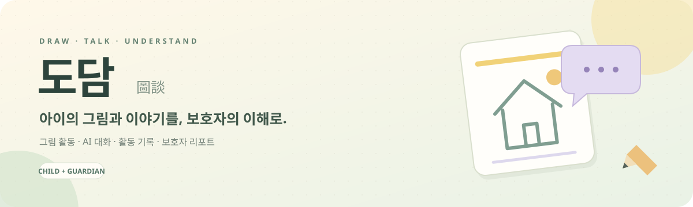
  <br /><br />
  
  <p><strong>아이의 그림과 이야기를 보호자의 이해로 연결하는 서비스</strong></p>
  <p>그림 그리기 · AI 대화 · 활동 기록 · 보호자 리포트</p>
  
  
  
  
</div>

<p align="center">
  <a href="#서비스-화면과-흐름">서비스 둘러보기</a> ·
  <a href="#주요-기능">주요 기능</a> ·
  <a href="#담당-구현">담당 구현</a> ·
  <a href="#시스템-구조">시스템 구조</a> ·
  <a href="#개발과-테스트">개발 가이드</a>
</p>

---

## 프로젝트 소개

도담은 만 4~12세 아동이 그림과 대화로 생각과 감정을 표현하고, 보호자가 그 활동 기록을 확인하도록 돕는 서비스입니다. 아동의 그림·대화·활동 과정을 함께 다루며, AI 분석 결과는 보호자의 이해와 대화를 돕는 참고 정보로 제공합니다. 심리 진단이나 치료를 제공하지 않습니다.

| 기간 | 팀 규모 | 프로젝트 | 담당 |
| --- | --- | --- | --- |
| 2026.07.06 ~ 2026.08.14 | 6명 | SSAFY 공통 프로젝트 | 강병구 · Backend |

## 서비스 화면과 흐름

### 아이의 하루: 선택하고, 그리고, 이야기하기

**아동 선택 → 활동 시작 → 그림·AI 대화 → 감정 선택 → 활동 완료**

아동은 자신만의 캐릭터와 함께 그림을 그립니다. 그림을 그리는 동안 AI의 질문에 답하거나 건너뛸 수 있고, 마친 뒤 현재 마음을 선택해 활동을 저장합니다.

<table>
  <tr><th width="50%">01 · 아동 선택</th><th width="50%">02 · 활동 시작</th></tr>
  <tr>
    <td><a href="docs/readme/screens/아동선택.png">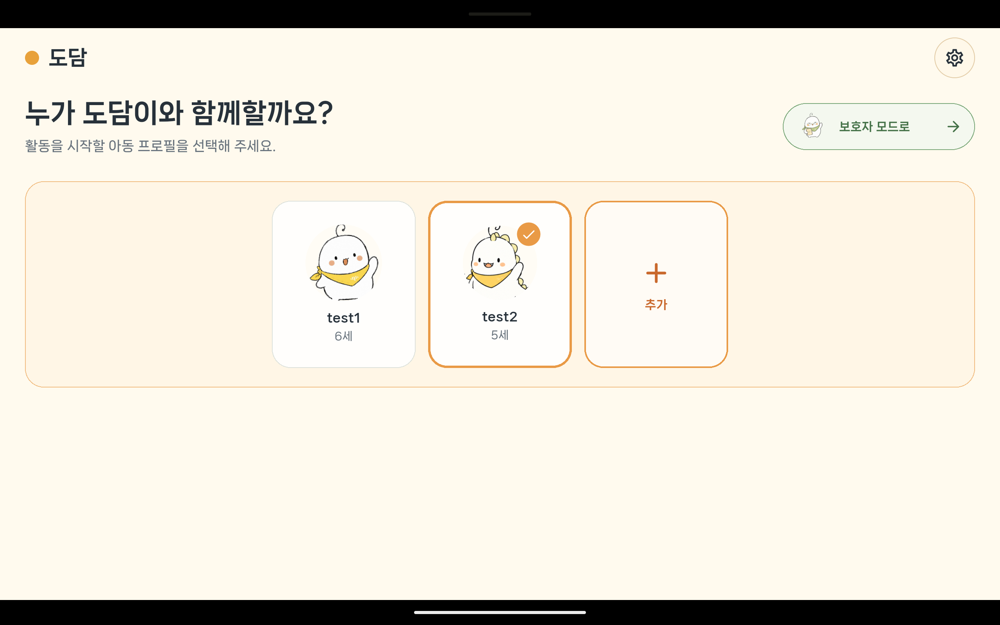</a></td>
    <td><a href="docs/readme/screens/아동홈.png">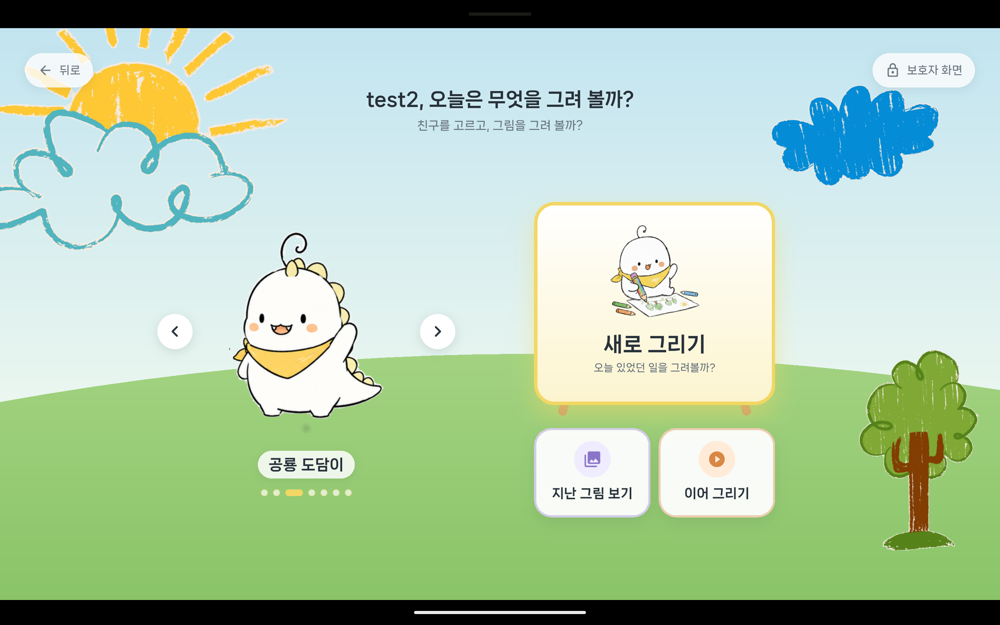</a></td>
  </tr>
  <tr><td>아동 프로필을 선택하고 보호자 모드와 구분합니다.</td><td>새 그림을 시작하거나 저장한 그림을 이어 그립니다.</td></tr>
  <tr><th>03 · 그림 그리기</th><th>04 · AI와 대화</th></tr>
  <tr>
    <td><a href="docs/readme/screens/캔버스그리기.png">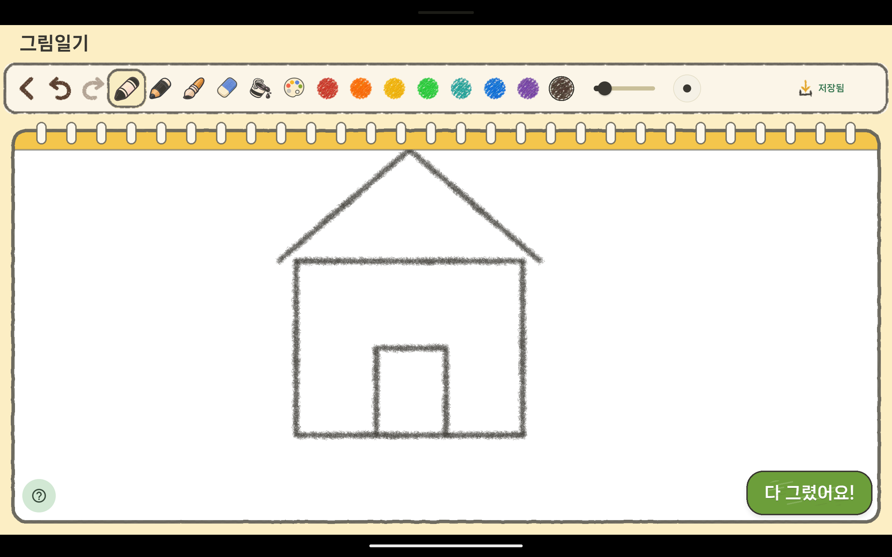</a></td>
    <td><a href="docs/readme/screens/AI캐릭터대화.png">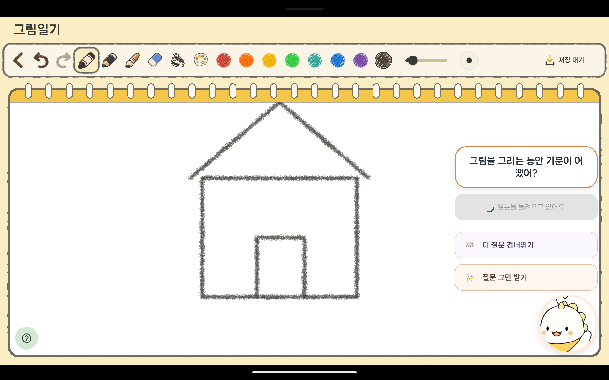</a></td>
  </tr>
  <tr><td>도구·색상·굵기를 골라 생각을 그림으로 표현합니다.</td><td>캐릭터의 질문에 답하고, 원하면 질문을 건너뛰거나 멈춥니다.</td></tr>
  <tr><th>05 · 마음 고르기</th><th>06 · 활동 완료</th></tr>
  <tr>
    <td><a href="docs/readme/screens/감정선택.png">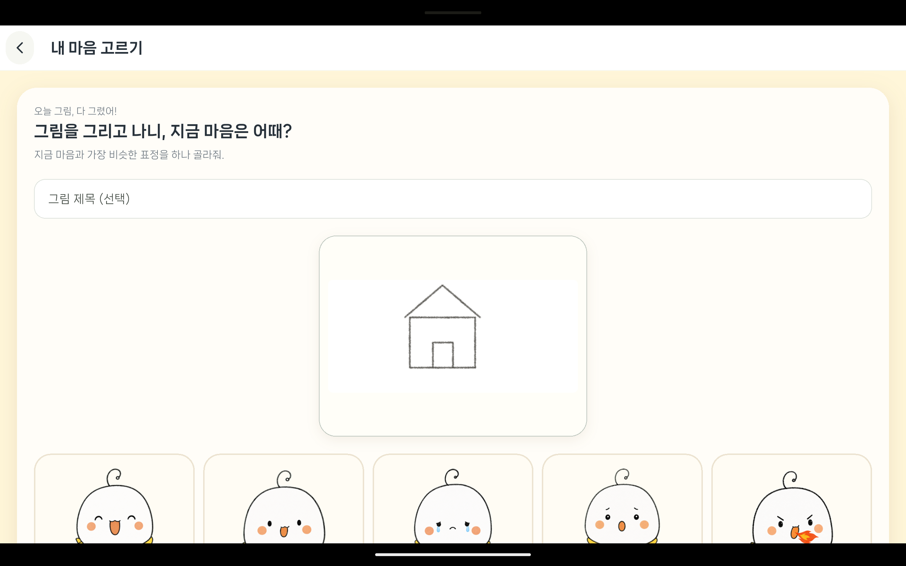</a></td>
    <td><a href="docs/readme/screens/활동완료.png">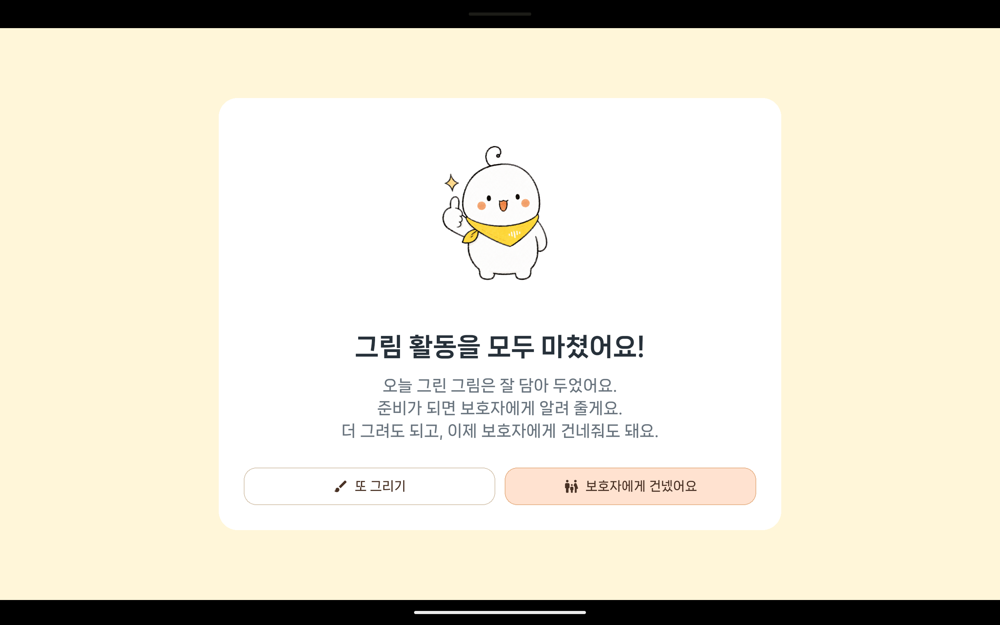</a></td>
  </tr>
  <tr><td>그림의 제목과 현재 기분을 함께 남깁니다.</td><td>저장 안내를 확인하고 보호자에게 기기를 건넵니다.</td></tr>
</table>

### 보호자의 확인: 한 번의 활동을, 쌓이는 기록으로

**보호자 홈 → 아동별 활동 기록 → 리포트 열람**

<table>
  <tr><th width="50%">07 · 보호자 홈</th><th width="50%">08 · 활동 기록</th></tr>
  <tr>
    <td><a href="docs/readme/screens/보호자홈.png">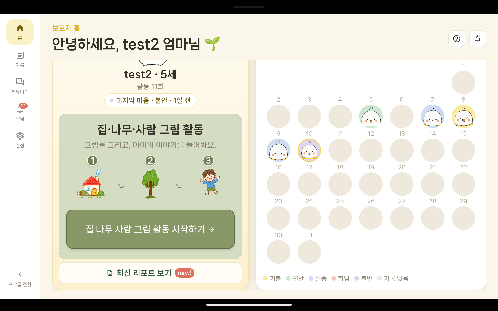</a></td>
    <td><a href="docs/readme/screens/활동기록.png">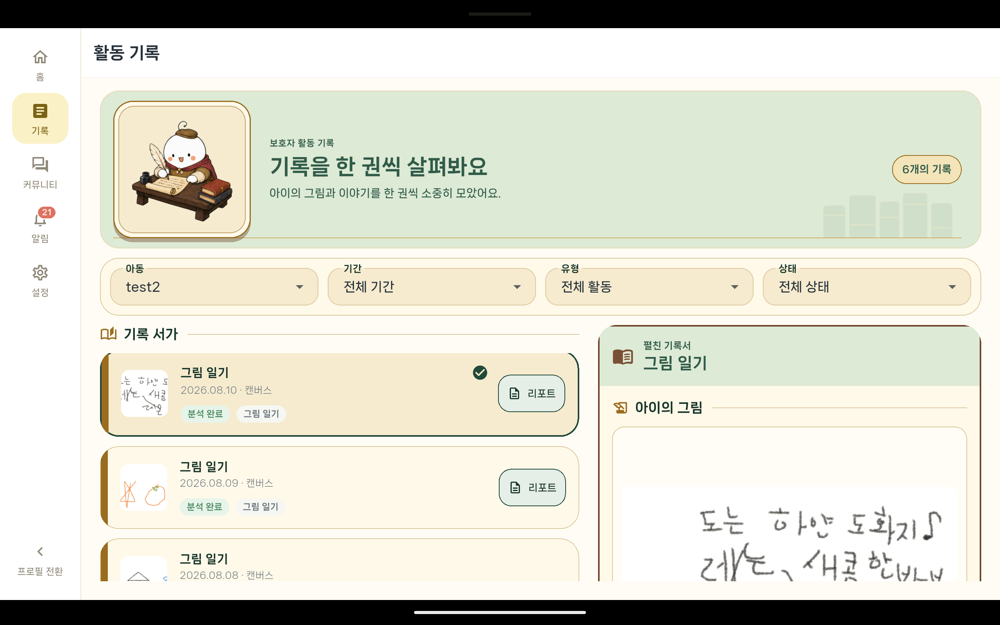</a></td>
  </tr>
  <tr><td>활동 현황과 감정 달력을 확인하고 새 활동을 안내합니다.</td><td>기간·유형·상태로 기록을 찾고 각 활동의 리포트를 엽니다.</td></tr>
</table>

<details>
<summary><strong>활동 시작 안내 화면 더 보기</strong></summary>

집·나무·사람 활동의 순서와 참고용 분석의 범위를 보호자에게 먼저 안내합니다.

<a href="docs/readme/screens/활동시작안내.png">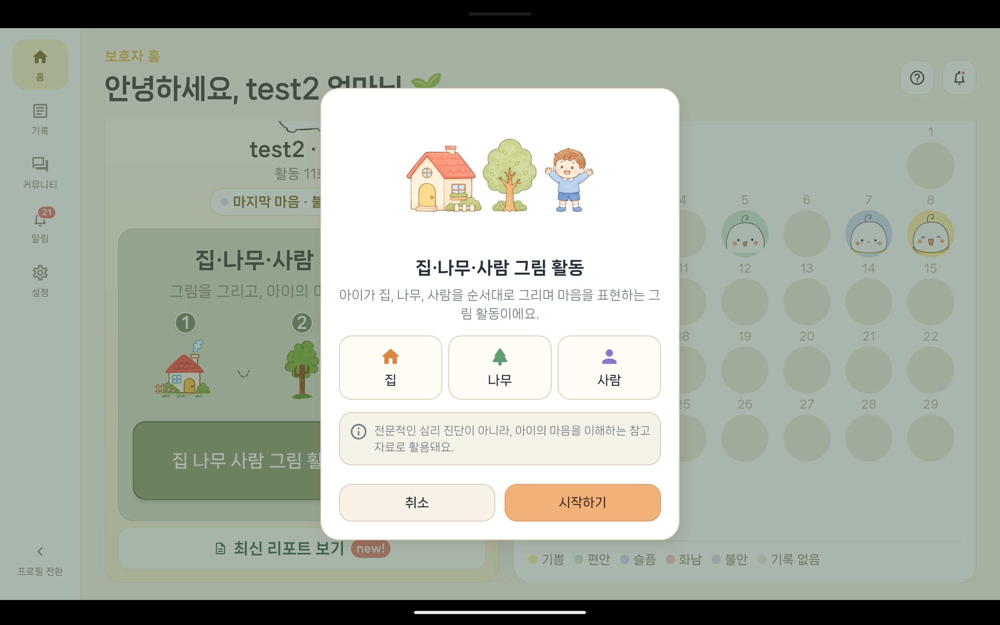</a>

</details>

<sub>기존 프로젝트의 시연 화면입니다. 각 이미지를 누르면 원본 크기로 볼 수 있습니다. 분석과 리포트는 보호자의 이해를 돕는 참고 정보이며 진단·치료를 대신하지 않습니다.</sub>

---

## 주요 기능

| 기능 | 처리 내용 |
| --- | --- |
| 보호자 인증 | OAuth 로그인, JWT 발급, Refresh Token 회전과 재사용 감지 |
| 아동 활동 | 그림 활동 생성·초안 저장·재개·완료, 스트로크 묶음 저장 |
| 접근 권한 | 보호자·아동·그림 활동의 관계를 데이터 조회 전에 확인 |
| 그림 및 대화 분석 | 백엔드에서 AI 분석 계약을 호출하고 필수 응답과 상태를 검증 |
| 보호자 리포트 | 그림·대화·분석 정보를 서버 PDF로 제공 |
| 이미지 저장 | 메타데이터 제거, 방향 보정, 입력 크기 검증 후 저장 |

## 담당 구현

**강병구 · Backend** — 인증·자원 접근 검증, 그림 활동 API와 AI Client, 서버 PDF 리포트 구현을 담당했습니다. 서비스 화면은 팀 공동 산출물입니다.

<details open>
<summary><strong>01 · 인증과 자원 접근 권한</strong></summary>

로그인한 보호자라는 사실과 대상 아동의 보호자라는 사실을 분리했습니다. 공통 Validator에서 인증 사용자와 아동·그림 활동의 소유 관계를 확인하고, 연결되지 않은 보호자나 삭제된 자원은 실제 조회 전에 차단합니다.

Refresh Token은 Redis에서 토큰 묶음·기기·현재 해시·만료 시간을 관리합니다. Lua 스크립트로 검증·새 해시 교체·만료 시간 갱신을 함께 처리하고, 이미 교체된 토큰의 재사용을 감지하면 해당 토큰 묶음을 폐기합니다.

- [자원 접근 검증](backend/src/main/java/com/ssafy/b209/auth/authorization/GuardianResourceAccessValidator.java)
- [Refresh Token 세션 저장소](backend/src/main/java/com/ssafy/b209/auth/service/RedisRefreshTokenSessionStore.java)
- [접근 권한 테스트](backend/src/test/java/com/ssafy/b209/auth/authorization/GuardianResourceAccessValidatorTest.java)

</details>

<details>
<summary><strong>02 · 그림 활동과 AI 연동</strong></summary>

그림 활동의 생성·저장·재개·완료 API와 AI 분석 Client를 구현했습니다. 분석 요청의 이미지 접근 수명을 제한하고 응답 필드·상태를 검증합니다. 분석과 리포트의 실패·재시도를 구분해 활동 완료 상태와 후속 처리 상태를 각각 관리합니다.

</details>

<details>
<summary><strong>03 · 서버 PDF 리포트</strong></summary>

팀이 서버 PDF를 정본으로 두기로 결정한 뒤 PDFBox와 openhtmltopdf를 비교했습니다. HTML/CSS 기반의 PDF 전용 템플릿을 사용하고, 인증 URL을 다시 호출하는 대신 저장소에서 이미지 자산을 읽도록 구현했습니다.

- [리포트 이미지 자산 처리](backend/src/main/java/com/ssafy/b209/report/service/StorageReportAssetResolver.java)
- [관련 테스트](backend/src/test/java/com/ssafy/b209/report/service/StorageReportAssetResolverTest.java)

</details>

6명이 Backend, Frontend, Infra/Data·AI를 나누어 개발했습니다. 위 담당 구현은 강병구의 작업 범위이며, AI 모델 개발과 전체 프론트엔드·인프라를 단독 구현한 프로젝트는 아닙니다.

## 시스템 구조

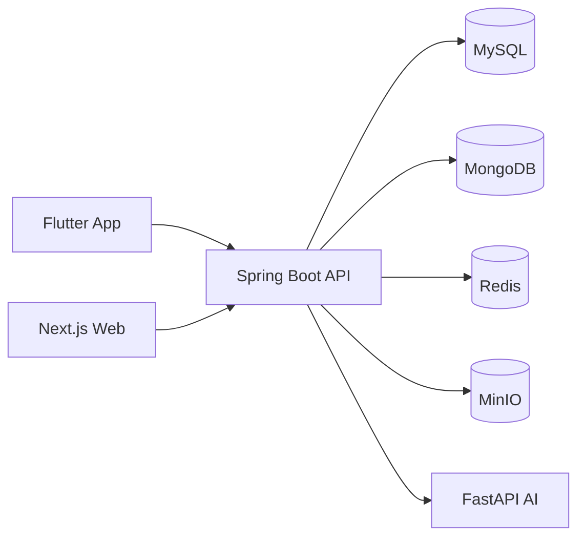

MySQL은 사용자와 활동 상태, MongoDB는 스트로크·행동 이벤트, Redis는 단기 인증 상태와 캐시, MinIO는 이미지·오디오·PDF 객체를 담당합니다. AI 서비스는 백엔드를 통해 연동합니다.

## 기술 스택

| 영역 | 기술 |
| --- | --- |
| Backend | Java 21, Spring Boot, JPA, Gradle |
| Frontend | Flutter, Dart, Next.js, React, TypeScript |
| AI | Python, FastAPI |
| Data | MySQL, MongoDB, Redis, MinIO |
| Report | PDFBox, openhtmltopdf |
| Runtime | Docker Compose |

## 디렉터리 구조

```text
dodam/
├── backend/             # Spring Boot API와 테스트
├── frontend/
│   ├── mobile/          # Flutter 아동·보호자 앱
│   └── web/             # Next.js 웹
├── ai/                  # FastAPI AI 서비스
├── infra/               # 실행 환경과 인프라 구성
├── docs/                # 설계·기술 문서와 서비스 화면
├── exec/                # 프로젝트 산출물 경로
├── tools/               # 개발 도구
└── README.md
```

## 개발과 테스트

<details>
<summary><strong>로컬 개발 환경 준비</strong></summary>

각 서비스의 환경변수와 데이터 저장소를 먼저 설정합니다. 운영 비밀값은 저장소에 포함하지 않으며 필요한 값은 로컬 환경에서 주입합니다.

```bash
# Backend
cd backend
./gradlew bootRun

# Web — 별도 터미널
cd frontend/web
pnpm install
pnpm dev

# Mobile — 별도 터미널
cd frontend/mobile
flutter pub get
flutter run
```

</details>

<details>
<summary><strong>테스트 실행</strong></summary>

```bash
cd backend
./gradlew test

cd frontend/mobile
flutter test

cd frontend/web
pnpm test:unit
```

통합 테스트에는 데이터 저장소와 Docker 환경이 필요할 수 있습니다. 설정·이미지·데이터의 외부 제공 범위에 따라 로컬 실행 전에 추가 준비가 필요합니다.

</details>
